<!-- Verge Currency GitHub organization profile | assets are hosted in this repository -->

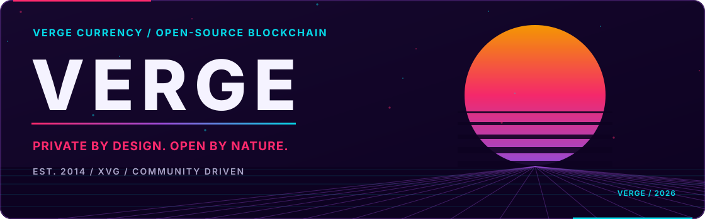

Official source code, wallets, tools and infrastructure for the Verge blockchain ecosystem. Building open-source cryptocurrency technology since 2014.

## featured projects

<a href="https://github.com/vergecurrency/verge">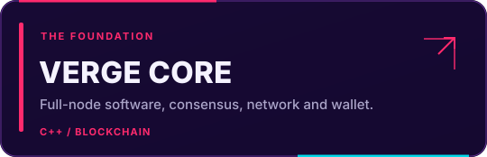</a>
<a href="https://github.com/vergecurrency/vergexvr">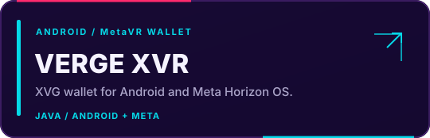</a>

<a href="https://github.com/vergecurrency/vIOS">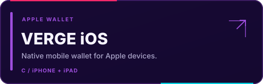</a>
<a href="https://github.com/vergecurrency/VergeSlim">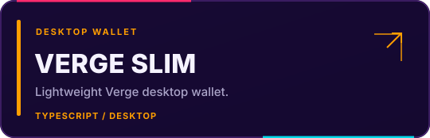</a>

<a href="https://github.com/vergecurrency/electrumx">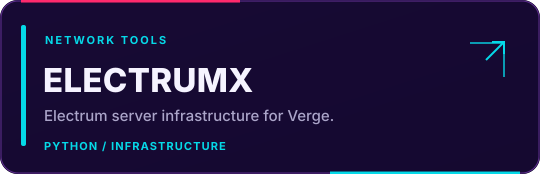</a>
<a href="https://github.com/vergecurrency/verge-mempool">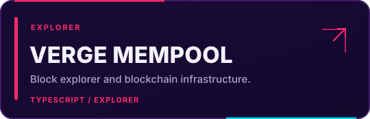</a>

<a href="https://github.com/vergecurrency/vergecurrency.com">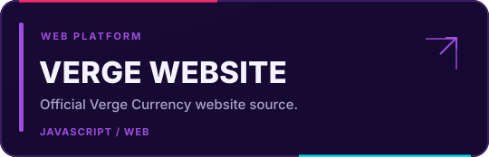</a>
<a href="https://github.com/vergecurrency/xvgtokens.com">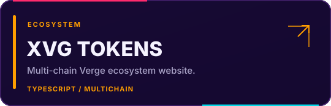</a>

## development libraries

<a href="https://github.com/vergecurrency/nodejs-verge">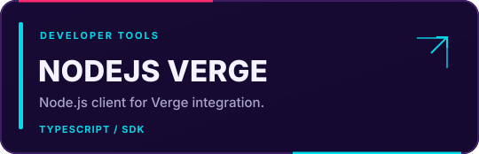</a>
<a href="https://github.com/vergecurrency/verge-python3">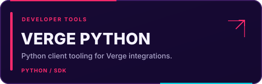</a>

## project activity

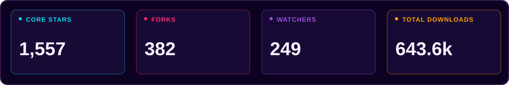

<a href="https://github.com/vergecurrency/verge/stargazers">Stars</a> &nbsp;·&nbsp; <a href="https://github.com/vergecurrency/verge/forks">Forks</a> &nbsp;·&nbsp; <a href="https://github.com/vergecurrency/verge/graphs/contributors">Contributors</a> &nbsp;·&nbsp; <a href="https://github.com/vergecurrency/verge/releases">Wallet releases</a> &nbsp;·&nbsp; <a href="https://github.com/vergecurrency/verge/actions">CI builds</a>

Statistics are generated into this repository by a scheduled GitHub Action rather than loaded from Shields.io at page view time. Initial placeholders appear until the workflow is run.

## community

<a href="https://www.youtube.com/channel/UCv59uw_WhHB2VxbBs0LPeeQ">YouTube</a> &nbsp;·&nbsp; <a href="https://x.com/vergecurrency">X</a> &nbsp;·&nbsp; <a href="https://discord.gg/vergecurrency">Discord</a> &nbsp;·&nbsp; <a href="https://t.me/officialxvg">Telegram</a>

## build with verge

From full-node software and lightweight wallets to explorers, client libraries and infrastructure, Verge is developed openly by its community. Explore the repositories, report issues and submit pull requests.

<a href="https://github.com/orgs/vergecurrency/repositories"><strong>EXPLORE ALL VERGE REPOSITORIES</strong></a>

